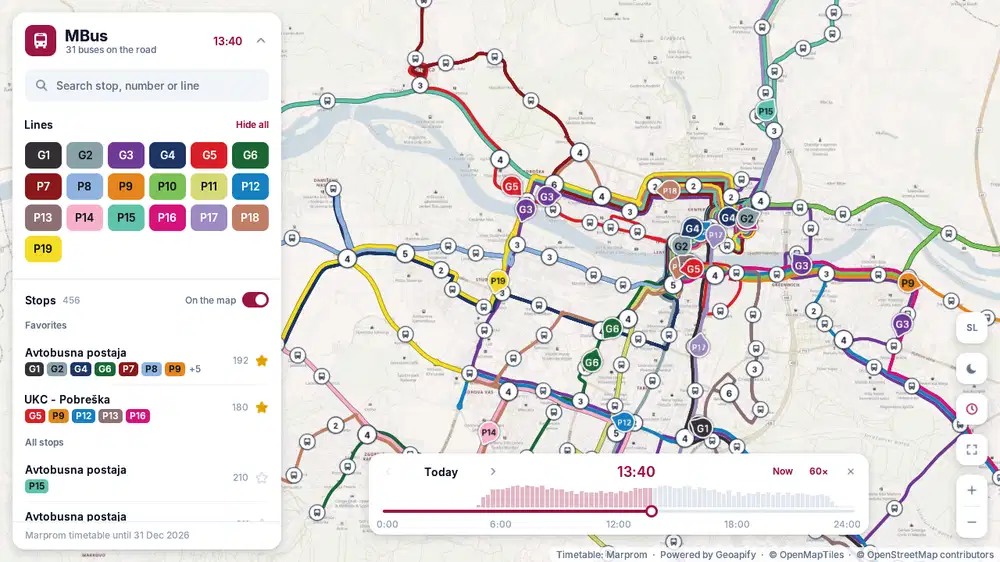
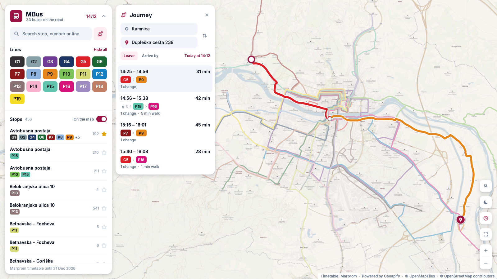
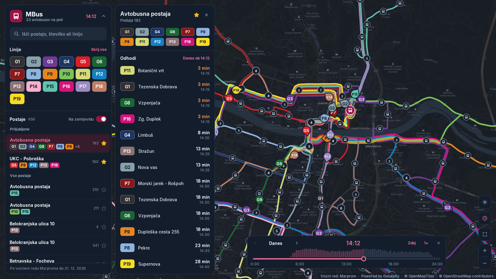

# MBus

**Every city bus in Maribor, Slovenia, on one animated map.** A desktop app in Java and LibGDX that plays the official timetable: 19 lines, 456 stops and about 1,100 trips on a weekday.

[](https://github.com/OAndrija/mbus-tracker/actions/workflows/build.yml)
[](../../releases)




**[Download](../../releases)** for Windows (no Java needed) or as a JAR for any system with Java 17.

## What it does

- **See** every bus move along its route, speeding up, braking at stops and turning with the road
- **Find** a stop by name, number or line, and see its next departures
- **Plan** a journey between any two addresses, stops or points of the map, with changes and walks along the streets
- **Follow** a bus and all its upcoming stops
- **Travel in time** to any minute the timetable covers, at up to 60× speed
- Favorites, dark mode, English and Slovene, works offline

Positions come from the timetable; they are not live.

| Overview | Journey planner | Dark mode |
|---|---|---|
|  |  |  |

## Engineering highlights

| Problem | Solution | Result |
|---|---|---|
| Up to 11 lines share one street and hide each other | Match routes by distance and direction, give each line a lane, draw them in a shader ([`LineLayout`](core/src/main/java/com/mbus/app/systems/map/LineLayout.java), [`LineLayer`](core/src/main/java/com/mbus/app/systems/map/LineLayer.java)) | All lines visible; CPU per frame 2.6 → 0.9 ms |
| Find the best connections, not just one | RAPTOR, repeated for every useful departure, with walks and changes ([`JourneyPlanner`](core/src/main/java/com/mbus/app/systems/journey/JourneyPlanner.java)) | About 6 ms per search; same best arrivals as a naive search in 250 random queries |
| Walks are not straight lines, and the river has few bridges | Shortest ways on a street network of 32,700 edges, made from OpenStreetMap by an own PBF reader ([`WalkNetwork`](core/src/main/java/com/mbus/app/systems/streets/WalkNetwork.java), [`ExtractStreets`](tools/src/main/java/com/mbus/tools/ExtractStreets.java)) | 315 MB → 0.8 MB with 23,000 addresses; works offline |
| Buses stuttered and spun | Distance along the route with easing; front and rear both follow the road ([`PatternMotion`](core/src/main/java/com/mbus/app/systems/map/PatternMotion.java), [`RouteTrack`](core/src/main/java/com/mbus/app/systems/map/RouteTrack.java)) | Frames without movement while driving 90% → 0.2% |
| 841 map tiles filled the memory | One small overview plus streamed, cached tiles for the visible area ([`MapTileLayer`](core/src/main/java/com/mbus/app/systems/map/MapTileLayer.java)) | Memory 1.1 → 0.4 GB |
| The timetable expires | Background updates that are validated before use, and a stand-in week ([`TimetableUpdater`](core/src/main/java/com/mbus/app/systems/data/TimetableUpdater.java)) | Keeps working after the last day |
| Blurry, stock-looking interface | Fonts, shapes and icons rendered at startup for the screen's density ([`Theme`](core/src/main/java/com/mbus/app/ui/theme/Theme.java)) | No image assets in the interface |

93 tests run on Linux, Windows and macOS with every push. They follow a bus of every route frame by frame, check the real timetable and streets, and compare the journey planner with an independent algorithm.

## Run it

```bash
git clone https://github.com/OAndrija/mbus-tracker.git
cd mbus-tracker
./gradlew lwjgl3:run
```

**Built with** Java 17, LibGDX (Scene2D, GLSL, FreeType), GTFS and Gradle. Architecture, shortcuts and build details are in [docs/DEVELOPMENT.md](docs/DEVELOPMENT.md).

## License

[MIT](LICENSE) for the code. Data, map and font sources are in [CREDITS.md](CREDITS.md).
